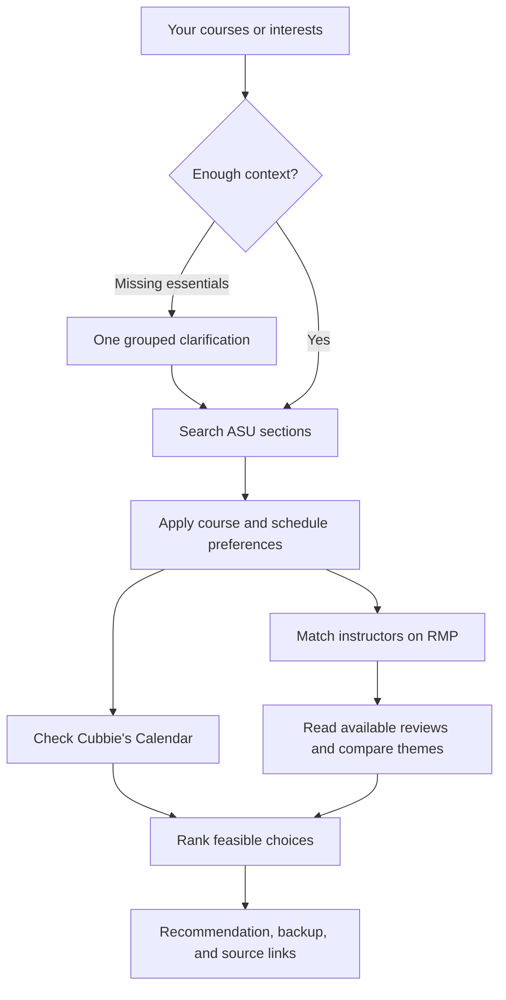

# ClassCue

### Find your class. Know your professor. Make it fit.

ClassCue turns ASU registration research into a conversation with [Cubbie](https://cubbie.ai/). Bring a course code, a subject, or an interest. Get a focused shortlist with real section details, professor review evidence, schedule checks, and a backup choice.

Built for Track 1 of the [Cubbie Hackathon](https://hackathon.cubbie.ai/) by **Inert SI** — Anish Pravin Kulkarni and Bhavesh Balaji.

## Try it on Cubbie

Send this link to Cubbie and approve installation:

```text
https://github.com/aniiishhh/cubbie-class-registration-buddy/tree/main/asu-registration-buddy
```

Then send a request:

> Compare CSE 575, 510, 512, and 572 for Spring 2027. I'm a Tempe campus student, prefer afternoon classes, and care about clear teaching and manageable workload. Check my Calendar too.

No course code yet? Start with an interest:

> Find a three-credit, 500-level CSE class related to machine learning for Spring 2027. Show me the best fits and explain the professor tradeoffs.

Cubbie groups missing essentials into one or two short rounds. Give as much detail as you like; optional preferences stay optional.

## What ClassCue brings together

| Capability | What you get |
| --- | --- |
| **ASU Class Search** | Direct live-query support for semester, subject, course, keyword, instructor, and session, with filters for location, level, credits, modality, days, and times. |
| **Course discovery** | A bounded shortlist from your interests or catalog designations, even without a course code. |
| **Professor insight** | Live Rate My Professors lookup, careful ASU identity matching, and full available review pagination with explicit coverage. Cubbie reads review text in batches and weighs recurring themes, mixed opinions, recency, and course relevance. |
| **Schedule fit** | Cubbie's existing Google Calendar connection checks meetings against commitments, alongside your stated preferences. |
| **A useful backup** | Another section of your chosen course, checked against the same constraints when one fits. |
| **Traceable answers** | Official ASU course/section links, RMP profiles, source timestamps, and clear unknowns. |

Supports all ASU subjects and campuses, including ASU Online and campus-student iCourses. It distinguishes program eligibility from where a class is taught.

## From request to recommendation



## Designed for real registration decisions

ClassCue explains why a section fits, what students say about its instructor, and what still needs checking. It prioritizes hard constraints before preferences and does not treat a high rating as proof of a good fit.

Source availability and freshness vary; ClassCue labels the evidence it actually used. Seat counts can change, and a listing does not establish enrollment eligibility. Confirm prerequisites, reserved seats, and required lab or recitation components on ASU. RMP comments are student opinions, with overall and course-specific evidence kept separate.

ClassCue helps research courses and sections. It does not perform a degree audit, build a guaranteed full-semester plan, enroll you, or modify your registration cart.

## Simple to install, easy to inspect

The [installable Skill](asu-registration-buddy/) is self-contained: Python helpers, public-source clients, and instructions for Cubbie. No hosted backend, student password, separate LLM key, or custom Calendar integration is required. Calendar details stay with Cubbie and are never sent to ASU or RMP by these scripts.

- [Skill workflow](asu-registration-buddy/SKILL.md) — how Cubbie interprets and handles requests
- [Command reference](asu-registration-buddy/references/commands.md) — inputs, outputs, and source modes
- [Acceptance checks](asu-registration-buddy/references/testing.md) — verify the installed experience
- [Contributing](CONTRIBUTING.md) — local setup, tests, and data maintenance

Text the same install link again after an update so Cubbie refreshes its installed copy.
